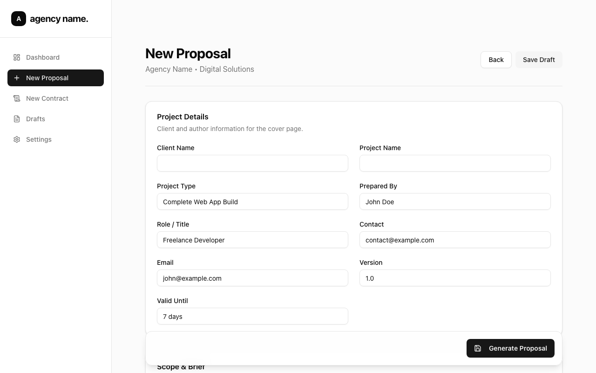

# Project Proposal

Open-source proposal and contract PDF generator for agencies and freelancers. Built by [InfraSurge](https://github.com/HimashaHerath).

Live: [project-proposal-silk.vercel.app](https://project-proposal-silk.vercel.app)



## Features

- **Proposal Generator** - Create professional project proposals with cover page, scope, pricing, timeline, and terms
- **Contract Generator** - Generate Master Services Agreements with legal clauses and signature blocks
- **PDF Export** - Server-side PDF generation via `@react-pdf/renderer` (no browser/Chromium needed)
- **API-first** - REST endpoints for programmatic PDF generation
- **Vercel-ready** - Deploys within Hobby tier limits (no heavy dependencies)
- **Settings** - Save your brand name, author info, and reuse across documents
- **Draft Management** - Save and resume proposal drafts via localStorage

## Quick Start

```bash
git clone https://github.com/HimashaHerath/project_proposal.git
cd project_proposal
npm install
npm run dev
```

Open [http://localhost:3000](http://localhost:3000).

## Project Structure

```
src/
├── app/
│   ├── (dashboard)/          # Dashboard layout with sidebar
│   │   ├── dashboard/        # Home dashboard
│   │   ├── proposal/new/     # Proposal form
│   │   ├── contract/new/     # Contract form
│   │   ├── proposal/drafts/  # Saved drafts
│   │   └── settings/         # Author/brand settings
│   ├── proposal/preview/     # Proposal preview page
│   ├── contract/preview/     # Contract preview page
│   └── api/
│       ├── pdf/              # Unified PDF endpoint (legacy)
│       ├── proposal/pdf/     # POST - Generate proposal PDF
│       └── contract/pdf/     # POST - Generate contract PDF
├── components/
│   ├── preview/              # A4 page components (browser preview)
│   ├── contract/             # Contract form & preview
│   └── ui/                   # shadcn/ui components
└── lib/
    ├── pdf/                  # @react-pdf/renderer templates
    │   ├── styles.ts         # Shared PDF styles
    │   ├── proposal-template.tsx
    │   └── contract-template.tsx
    ├── schema.ts             # Proposal Zod schema
    ├── contractSchema.ts     # Contract Zod schema
    ├── store.ts              # Proposal localStorage store
    └── settingsStore.ts      # Settings localStorage store
```

## API Usage

### Generate a Proposal PDF

```bash
curl -X POST http://localhost:3000/api/proposal/pdf \
  -H "Content-Type: application/json" \
  -d '{
    "clientName": "Acme Corp",
    "projectName": "Website Redesign",
    "projectType": "Web Development",
    "authorName": "Jane Smith",
    "authorRole": "Lead Developer",
    "authorContact": "+1 555-0100",
    "authorEmail": "jane@agency.com",
    "version": "v1.0",
    "validUntil": "2026-03-01",
    "overview": "Complete redesign of the Acme Corp website with modern tech stack.",
    "successCriteria": "Site shipped, analytics installed, conversion-ready",
    "includedScope": ["UI/UX Design", "Frontend Development", "CMS Integration"],
    "excludedScope": ["Logo Design", "Copywriting"],
    "assumptions": ["Client provides brand assets", "Weekly feedback loops"],
    "pricingItems": [
      { "description": "Design Phase", "price": 3000 },
      { "description": "Development Phase", "price": 5000 }
    ],
    "paymentSchedule": "50% upfront, 50% on delivery",
    "revisions": "2 rounds per milestone",
    "milestones": [
      { "phase": "Design", "duration": "2 weeks" },
      { "phase": "Development", "duration": "4 weeks" }
    ],
    "startCondition": "Timeline starts after contract + deposit",
    "feedbackDependency": "Delays in feedback extend timeline",
    "terms": [
      "Payment: 50% upfront, 50% on delivery.",
      "Revisions: 2 rounds per milestone included.",
      "IP Transfer: Upon full payment, all rights transfer to client."
    ]
  }' \
  --output proposal.pdf
```

### Generate a Contract PDF

```bash
curl -X POST http://localhost:3000/api/contract/pdf \
  -H "Content-Type: application/json" \
  -d '{
    "clientName": "Acme Corp",
    "clientAddress": "123 Business Ave, Suite 100",
    "providerName": "Jane Smith Studio",
    "providerAddress": "456 Creative Blvd",
    "effectiveDate": "2026-02-18",
    "servicesDescription": "Design and development of corporate website.",
    "totalFee": 8000,
    "paymentTerms": "50% upfront, 50% on delivery",
    "confidentialityClause": "Both parties agree to treat all non-public information as confidential.",
    "ipRightsClause": "Upon full payment, Provider assigns all rights in Final Deliverables to Client.",
    "terminationClause": "Either party may terminate with 14 days written notice.",
    "governingLaw": "State of California"
  }' \
  --output contract.pdf
```

### Unified Endpoint (Legacy)

```bash
# Proposal
curl -X POST http://localhost:3000/api/pdf \
  -H "Content-Type: application/json" \
  -d '{ ...proposal data... }' \
  --output proposal.pdf

# Contract (add "type": "contract")
curl -X POST http://localhost:3000/api/pdf \
  -H "Content-Type: application/json" \
  -d '{ "type": "contract", ...contract data... }' \
  --output contract.pdf
```

## Tech Stack

- **Framework:** [Next.js](https://nextjs.org/) 16 (App Router)
- **UI:** [shadcn/ui](https://ui.shadcn.com/) + [Tailwind CSS](https://tailwindcss.com/) v4
- **Forms:** [React Hook Form](https://react-hook-form.com/) + [Zod](https://zod.dev/)
- **PDF:** [@react-pdf/renderer](https://react-pdf.org/)
- **Animations:** [Framer Motion](https://www.framer.com/motion/)

## Deploy to Vercel

[](https://vercel.com/new/clone?repository-url=https://github.com/HimashaHerath/project_proposal)

No environment variables are required. Just click deploy.

## Author

**Himasha Herath** - [InfraSurge](https://github.com/HimashaHerath)

## License

MIT
